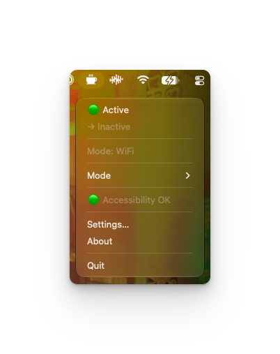
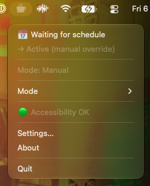
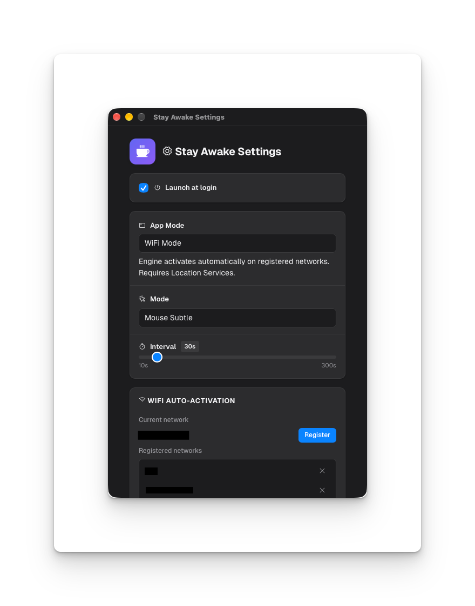
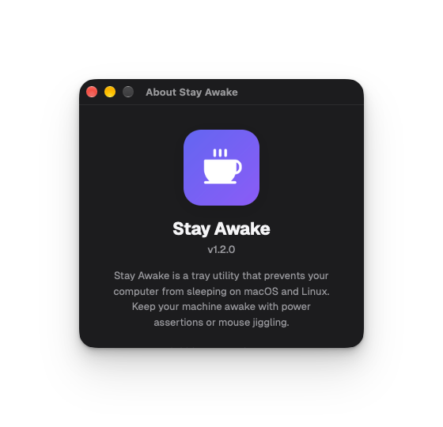

# Stay Awake

> Keep your computer awake and active: no sleep, no idle, no interruptions.

   

Stay Awake is a tray utility that prevents your computer from sleeping on macOS and Linux. It lives in the menu bar or system tray and stays out of your way. Built with Rust and Tauri v2.

## Screenshots

### Menu bar

<table>
  <tr>
    <td align="center"></td>
    <td align="center"></td>
  </tr>
  <tr>
    <td align="center">WiFi mode</td>
    <td align="center">Schedule</td>
  </tr>
</table>

### Settings



### About



## Features

- **Power Only**: prevents sleep without moving the mouse
- **Mouse Subtle**: moves the cursor 1 px right and back
- **Mouse Zen**: sends a zero-delta mouse event without visible movement
- **Mouse Circle**: traces a small square pattern, 1 pixel per step
- **WiFi mode**: starts the engine on a registered network and stops it on disconnect
- **Scheduling**: Manual and Always On follow scheduled windows; WiFi schedules only filter mouse jiggles and do not start or stop the engine
- **Tray status**: the original app icon dims when the engine is not active; the menu shows the current state, a greyed next-click result, and a greyed App Mode line (Manual, Always On, or WiFi)
- **Profiles**: save and load named settings profiles
- **Global hotkey**: toggle active/inactive from anywhere
- **Idle detection**: skips jiggle while you are using the mouse
- **Launch at Login**: configurable on desktop
- **macOS release metadata**: signed update metadata ships with macOS releases
- **Internationalization**: English, Spanish, French, German, Portuguese (BR), Japanese, Chinese (Simplified), and Korean

## Installation

### Homebrew (macOS, recommended)

```sh
brew install shoootyou/tap/stay-awake
```

### Manual download

**macOS**: Download the signed and notarized `.dmg` from the [GitHub Releases](https://github.com/shoootyou/stay-awake/releases) page, open it, and drag **Stay Awake** to your Applications folder.

**Linux (amd64)**: The published `.deb` is built and tested on Ubuntu 24.04. Older distributions are not validated. Download the `.deb` from the [GitHub Releases](https://github.com/shoootyou/stay-awake/releases) page, then install the file you downloaded:

```sh
sudo apt install ./<downloaded-file>.deb
```

The package declares `systemd` as a dependency and `xdotool` as a recommendation.

### Linux prerequisites

- **NetworkManager**: required for WiFi mode. Other modes work without it.
- **`xdotool`**: recommended for the mouse-jiggle modes (Subtle, Zen, Circle). `Power Only` works without it. The `.deb` declares `xdotool` as a `Recommends`.

**Why `Power Only` is the default on Linux:** mouse-jiggle modes use `xdotool` to inject absolute
mouse motion. The project could not confirm that this resets GNOME/Mutter's idle timer under
Wayland, so the default uses `systemd-inhibit` instead. On X11, you can choose Mouse Subtle,
Mouse Circle, or Mouse Zen in Settings if mouse jiggle works for your setup.

## Updates

**Homebrew (macOS)**: run `brew upgrade shoootyou/tap/stay-awake`.

**Manual DMG install (macOS)**: macOS releases publish signed update metadata. To update,
install the new DMG.

**Linux (.deb)**: Linux `.deb` installs do not use the in-app updater. Download the new `.deb` from [GitHub Releases](https://github.com/shoootyou/stay-awake/releases) and install it with `sudo apt install ./<downloaded-file>.deb`.

## System Requirements

**macOS**
- macOS 12 Monterey or later
- Apple Silicon

**Linux**
- A `systemd`-based distribution (Debian/Ubuntu and derivatives, via the `.deb` package; see the [Ubuntu 24.04 baseline](#manual-download))
- NetworkManager (for WiFi mode)
- `xdotool` (recommended, for mouse-jiggle modes)

## Development

### Prerequisites

- Rust `1.99.1` (pinned in `rust-toolchain.toml`)
- Node.js 26, matching CI
- Tauri CLI: `cargo install tauri-cli`
- Linux only: install the repository's build dependencies:
  ```sh
  scripts/install-linux-dependencies.sh
  ```

### Setup

```sh
npm install
npm run tauri dev
```

### Build

```sh
npm run tauri build
```

## Sponsor

If Stay Awake saves you from one more accidental sleep during a video call, consider [sponsoring the project on GitHub](https://github.com/sponsors/shoootyou). Every contribution helps keep development going.

## License

[MIT](LICENSE) © Rodolfo Castelo
